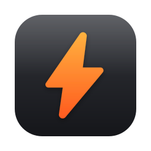
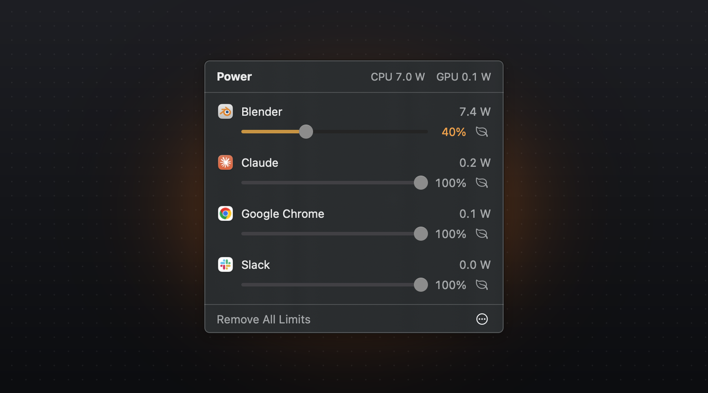

<p align="center">
  
</p>

<h1 align="center">PowerCap</h1>

<p align="center">
  <strong>Turn down any app's power, right from the menu bar.</strong><br>
  See which apps draw the most watts and cap them with a slider.
</p>

<p align="center">
  <a href="https://github.com/psykoloGG/PowerCap/releases/latest"></a>
</p>

<p align="center">
  
  
</p>

<p align="center">
  
</p>

## Why PowerCap

Unreal, Blender, a game, a runaway browser tab: some apps happily use every watt your Mac has. Activity Monitor shows you which ones, but the only fix it offers is quitting. PowerCap gives every app a power slider instead.

## Features

- **Live watts per app.** CPU and GPU power for every app, including its helper processes, updated every second while the panel is open.
- **A slider for every app.** Drag an app to 40% and it only runs 40% of the time. Its CPU and GPU draw drop with it.
- **Low-power mode.** The leaf button moves an app onto the efficiency cores. It keeps running without pauses, just slower, at a fraction of the power.
- **Remembers your limits.** Limits stay with each app and come back the next time it launches.
- **Safe by design.** If PowerCap quits or crashes, a small guardian process resumes every app it was limiting.
- **Light on its feet.** Uses about 0.3% of one CPU core while idle.

## Install

1. Download the DMG from the [latest release](https://github.com/psykoloGG/PowerCap/releases/latest).
2. Drag PowerCap to Applications and open it.
3. Click the bolt in the menu bar.

PowerCap needs an Apple Silicon Mac running macOS 14 or later. To start it automatically, choose **Open at Login** from the `...` menu in the panel.

## How it works

| | |
|---|---|
| **Power readings** | CPU watts come from the kernel's per-process energy counters. The GPU only reports energy for the whole chip, so each app gets a share based on how much GPU time it used. Helper processes, like browser renderers or Unreal's shader workers, count toward the app that started them. |
| **Slider** | Below 100%, PowerCap pauses and resumes the app in 50 ms cycles. At 20% an app runs for 10 ms out of every 50. While paused it can't use the CPU or queue new GPU work. |
| **Low-power mode** | Puts the app in macOS's background priority band, which keeps it on the efficiency cores. macOS also slows its disk and network access in this mode. |
| **Guardian** | PowerCap records every process it limits before limiting it. A tiny helper watches PowerCap and resumes those processes the moment it exits for any reason. |

## FAQ

<details>
<summary><strong>Will a limited app feel slower?</strong></summary>
<br>
Yes, that's the trade. At low settings, games and editors get choppy frame rates. For heavy apps like Unreal or Blender, 40-60% is a good place to start.
</details>

<details>
<summary><strong>Can it limit the GPU directly?</strong></summary>
<br>
macOS has no per-app GPU power control. A paused app can't queue new GPU work, though, so its GPU use drops along with the slider.
</details>

<details>
<summary><strong>Why isn't it on the Mac App Store?</strong></summary>
<br>
App Store apps run in Apple's sandbox, which doesn't allow pausing other apps or reading their energy use. PowerCap is signed with a Developer ID and notarized by Apple instead.
</details>

<details>
<summary><strong>Does it work on Intel Macs?</strong></summary>
<br>
No. The per-app energy counters and efficiency cores it relies on are Apple Silicon features.
</details>

<details>
<summary><strong>Which apps can't be limited?</strong></summary>
<br>
Finder, the Dock and other parts of the macOS desktop are excluded, so a limit can never freeze your Mac. Background processes that aren't apps don't appear in the list.
</details>

## Build from source

```bash
git clone https://github.com/psykoloGG/PowerCap.git
cd PowerCap
./scripts/build.sh --install
```

Requires Xcode 16 or later. `scripts/release.sh` builds the signed and notarized DMG that ships with each release.
